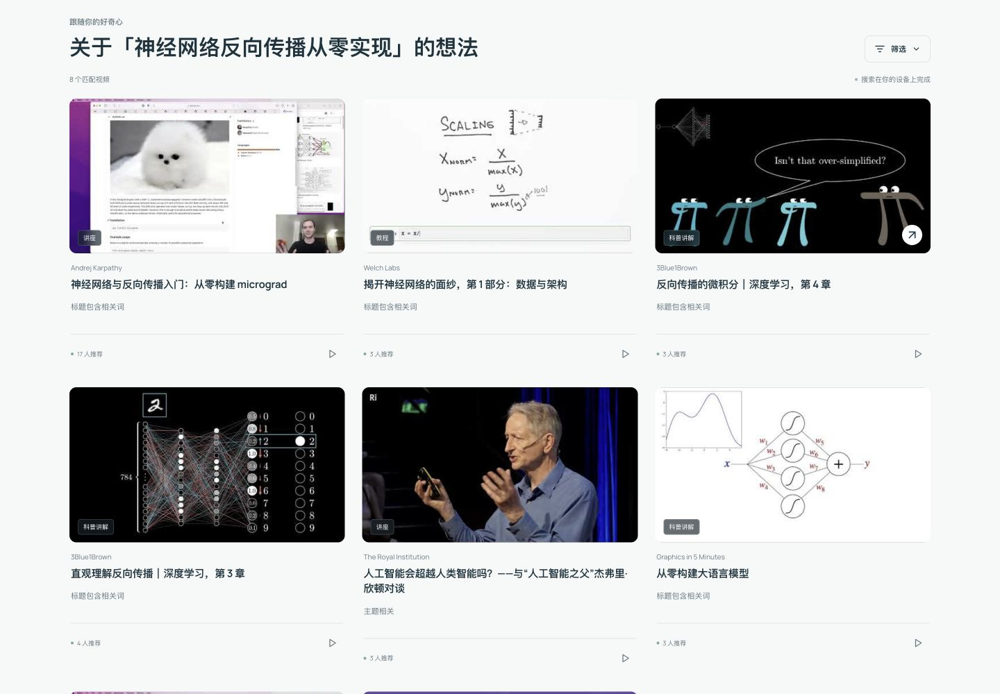
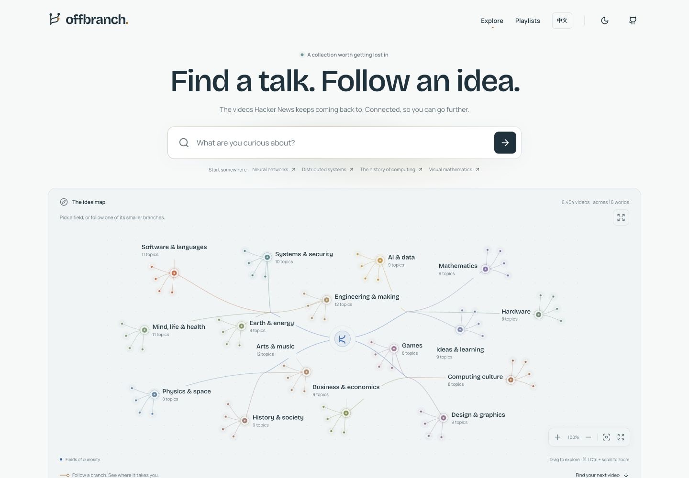
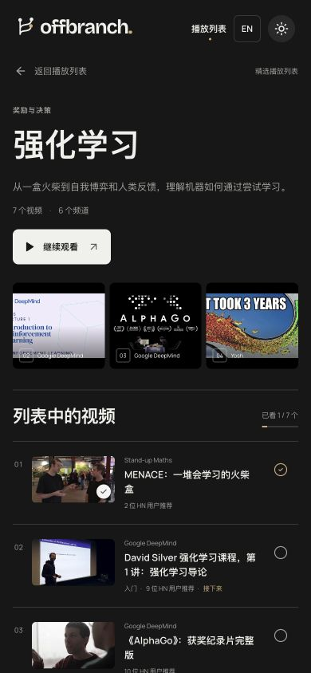

# Offbranch

**Find a talk. Follow an idea.**

[Open Offbranch](https://thesybuilder.github.io/offbranch/) · [TheSyBuilder on X](https://x.com/TheSyBuilder)

Explore 6,454 videos from HackerTube's collection, see how ideas connect, and watch curated topic playlists. No account, API key, analytics, or live AI calls.

## What you can do

- Search titles, creators, topics, and recommendation context, with typo correction and editable goal/background patterns.
- Explore 16 fields and 150 topics through a responsive, keyboard-accessible map.
- Browse 12 curated playlists in a four-column desktop grid. Collections cover reinforcement learning, data collection, language models, coding agents, AI hardware, and related subjects. Each sequence is as long as its available material warrants.
- Open a dedicated playlist page, choose any video, and follow the next video from its watch page.
- Track watched videos locally and continue from the first unwatched item.
- Read HN recommendation evidence, watch on YouTube, use light or dark mode, and share playlist URLs.
- Switch between English and Simplified Chinese. Interface text, all 12 playlists, 16 areas and 150 topic labels are localized. Chinese titles, descriptions and recommendation summaries are indexed alongside the original English metadata across the full 6,454-video catalog.

Roadmap building is hidden. Existing local roadmap data is left untouched; the active interface uses curated playlists.

## Screenshots

Chinese search on desktop:



English desktop:



Chinese playlist on mobile:



## Run locally

Requires Node.js 22.12+ (Node 22 LTS recommended).

```sh
npm ci
npm run dev
```

Open the printed URL, including `/offbranch/`.

```sh
npm test
npm run build
npm run preview
```

The deployment workflow runs tests and a production build before publishing `main` to GitHub Pages. Vite's base path is `/offbranch/`. Enable **Settings → Pages → GitHub Actions** for a fork, and change the base and canonical metadata if its repository name differs.

## Data and search

The complete 2026-10-31 export is normalized into static assets in `public/data/`. Runtime search uses MiniSearch in a Web Worker, with separate English and Chinese metadata fields. Titles and topics receive more weight than descriptions and recommendation context. Chinese word segmentation, technical-term aliases, typo correction and editable goal/background patterns support Chinese, English and mixed queries.

This is bilingual weighted lexical search. It matches indexed words and known aliases; it does not offer unrestricted semantic search or understand every paraphrase. Existing BGE embeddings are used only during the data build to compute eight related-video neighbors. No embedding model or language model runs in the browser.

To reproduce the pinned data assets:

```sh
python3 -m pip install -r requirements.txt
npm run data:build
python3 scripts/build_playlists.py
```

The script verifies the archive's SHA-256. Raw source downloads stay in ignored `.cache/`. Evidence is split into small shards so opening a video loads only the relevant source context. See `public/data/provenance.json` for source metadata and `docs/search-benchmark.md` for the measured comparison and limitations.

```sh
npm run benchmark
```

Default search excludes news and videos with no actual recommendations. The stronger-evidence filter requires at least three recommenders, three distinct recommendation months, and one strong recommendation. Difficulty labels are weak upstream signals; “general” means unspecified. Relatedness is not a prerequisite relationship.

Durations, upload dates, view counts, and current availability are not in the reusable export. Offbranch does not invent them. Playback and thumbnails come directly from YouTube. Some videos may have become unavailable.

## Reproduce the Chinese catalog

`public/data/catalog-zh.json` contains static Chinese metadata for every catalog ID: a translated title where available, a description (`summary`), and an HN recommendation summary (`whyHn`). The asset is loaded when Chinese is selected or a Chinese query needs the bilingual index. The English source catalog remains intact. Loading, missing translations and network errors are shown explicitly; Chinese descriptions never silently fall back to English.

Translations are generated locally with the pinned `mlx-community/Qwen3-4B-Instruct-2507-4bit` model. Reviewed overrides in `scripts/catalog_zh_overrides.json` cover every curated playlist and homepage selection, plus flagged translation errors. The manifest records the current correction count. The remaining metadata is machine translated; the entire catalog has not been manually checked line by line. Original text is available through **查看原文** on each video page. Verbatim HN comments and creator/channel names retain their original text.

The optional authoring environment uses MLX on an Apple silicon Mac. It is separate from the website's Node dependencies and is not needed to run, build or deploy the app. Downloading the pinned model requires network access; generation then uses the local snapshot with network model downloads disabled.

```sh
python3 -m venv .cache/venv-translation
source .cache/venv-translation/bin/activate
python3 -m pip install -r requirements-translation.txt
python3 -c 'from huggingface_hub import snapshot_download; snapshot_download(repo_id="mlx-community/Qwen3-4B-Instruct-2507-4bit", revision="50d427756c6b1b2fe0c0a10f67fbda1fc8e82c1b")'
python3 scripts/translate_catalog_zh.py
python3 scripts/translate_catalog_zh.py --repair-titles
python3 scripts/check_catalog_zh.py --require-meta
```

The translation script resumes from ignored `.cache/catalog-zh-progress.jsonl`, keyed by the source text's hash. Use a fresh `--checkpoint` path if changing the model or translation prompt. Pass `--model-path /path/to/snapshot` for a different location of the pinned snapshot, or reduce `--batch-size` and `--prefill-batch-size` to fit available memory. `--limit N` runs a pilot without publishing a partial catalog. After a complete checkpoint or an override edit, `--finalize-only` rebuilds the public asset without model inference.

The companion `catalog-zh.meta.json` records the pinned model revision, source version, source/translation checksums, generation time and override count. The checker requires all 6,454 IDs, validates Chinese descriptions and rejects missing text, generation artifacts and checksum mismatches. It writes `artifacts/catalog-zh-review.json`; number, terminology and possible-truncation flags need review and are distinct from structural failures. Use `--strict-review` to fail on those flags too. Checker tests run with:

```sh
python3 -m unittest discover -s scripts -p 'test_*.py'
```

See [release verification](docs/verification.md) and [Chinese search benchmark](docs/search-benchmark-zh.md) for measured results and limits.

## Playlists, storage, and navigation

Curated sequences are reviewed ID lists in `scripts/build_playlists.py`, exported to `public/data/playlists.json`. The build validates metadata, topic IDs, video membership, recommendations, cover membership, and duplicates. See `docs/playlists.md` for the selection rationale and current-interest research. Playlists are editorial collections from a pinned archive, not a live popularity ranking.

Watched IDs, language and theme preferences stay in browser local storage. Clearing that storage removes progress. Playlist URLs use `?playlist=SLUG`; watch URLs keep that parameter alongside `?v=VIDEO_ID` so the next item and return link survive reload. A `lang=zh-CN` or `lang=en` query parameter pins the interface language for a shared link. Otherwise an explicit saved choice takes precedence over the browser language. English mode uses the original video metadata; Chinese mode uses the static translation asset, with source text available on the watch page. HN quotes remain original in both modes. No server or runtime secrets are needed.

## Architecture

React + TypeScript + Vite, custom CSS, SVG/D3 map controls, a bilingual MiniSearch worker, and a Python/NumPy data pipeline. The optional local MLX translation pipeline produces static JSON; the application makes no live AI calls. Browser history preserves search context and scroll. Tests cover search relevance, tokenization, filters, playlist integrity, page navigation and translation validation/fallback behavior; legacy roadmap validation tests remain while that interface is hidden.

## Credits

Inspired by [HackerTube](https://hackertube.org), created by Andrej Karpathy. Data derives from [open-index/hacker-news](https://huggingface.co/datasets/open-index/hacker-news).

Application code is MIT licensed. The dataset is ODC-By 1.0; see `DATA-LICENSE.md`. Comments belong to their authors; videos, titles, and channel names belong to their creators. Not affiliated with YouTube, Google, Hacker News, or Y Combinator.
